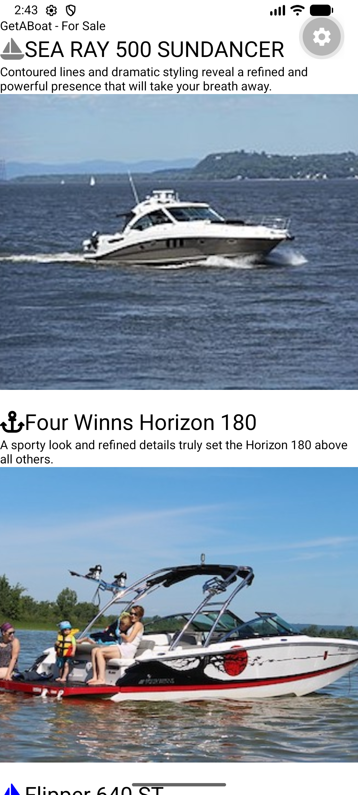

<!-- Create a file README.MD in L04Boats folder and paste following content in it -->
# L04 Bosts

A brief description of the mobile application and its purpose.  
(Example: This app allows users to manage tasks and sync data with a backend web service.)

# ScreenShots of App
Top page screenshot:  

Bottom page screenshot:  